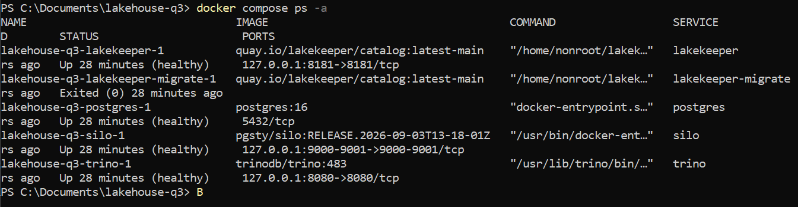
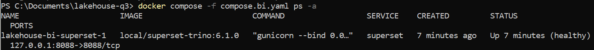
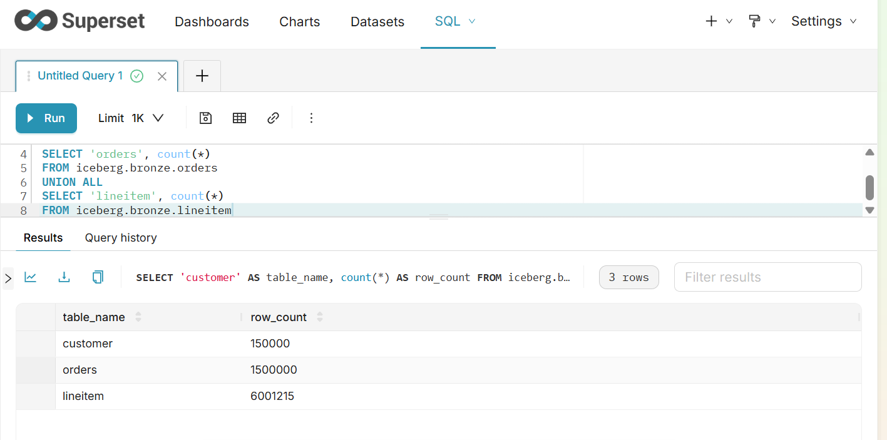

# Отчёт по практической работе №1

**Тема:** развёртывание локального Lakehouse, ELT-преобразование и бенчмарк форматов и сжатия.

## 1. Вариант и масштаб

| Поле | Значение |
|---|---|
| ФИО | Уваров Максим Сергеевич |
| Вариант | 1 — TPC-H Q3 «Shipping Priority» |
| Масштаб | sf1 |
| Почему выбран этот масштаб | Масштаб sf1 включает примерно 6 млн строк в lineitem. Этого достаточно, чтобы на локальном компьютере выполнить соединение трёх таблиц и аналитическую агрегацию. Для учебного сравнения форматов отдельный кластер не нужен; во всех слоях используется один и тот же исходный набор sf1. |

Источник — встроенный коннектор Trino `tpch`. Внешние файлы исходных данных не скачивались. Данные материализованы из `tpch.sf1` в собственные таблицы Iceberg.

Аппаратная среда: Windows, Docker Desktop с WSL2, 12 доступных Docker логических CPU, около 8 ГБ памяти Docker; оперативная память компьютера — 16 ГБ.

## 2. Поднятые сервисы и обоснование выбора

| Сервис | Роль в стеке | Почему выбран |
|---|---|---|
| Silo | S3-совместимое объектное хранилище | Даёт возможность хранить файлы данных и метаданные Iceberg локально и работать с ними через S3 API. Выбран вместо MinIO, поскольку возникли сложности с загрузкой изначально выбранных образов. |
| PostgreSQL 16 | База данных каталога Lakekeeper | Обеспечивает постоянное хранение служебной информации каталога. Реляционная БД подходит для небольших транзакционных записей каталога. |
| Lakekeeper 0.14.0 | Iceberg REST Catalog | Открывает доступ к каталогу через REST API, сопоставляет названия таблиц с метаданными и обслуживает операции каталога. |
| Trino 483 | SQL-движок | Совместим с TPC-H, Iceberg и S3, поэтому через один SQL-движок можно загрузить исходные данные, сформировать слои и запускать аналитические запросы. |
| Apache Superset 6.1.0 | Дополнительный BI-инструмент в Docker | Подключается к Trino, предоставляет SQL Lab и средства визуализации. Позволяет работать с Lakehouse без отдельной выгрузки таблиц. |
| DBeaver | SQL-клиент в Windows | Использован для выполнения SQL, просмотра результатов и чтения Execution из EXPLAIN ANALYZE. Не заменяет дополнительный инструмент в Docker. |

Использованные образы:

| Сервис | Образ |
|---|---|
| Silo | `pgsty/silo:RELEASE.2026-09-03T13-18-01Z` |
| PostgreSQL | `postgres:16` |
| Lakekeeper и миграции | `quay.io/lakekeeper/catalog:latest-main` |
| Trino | `trinodb/trino:483` |
| Superset с драйвером Trino | `local/superset-trino:6.1.0`, собран из `apache/superset:6.1.0` |

### Как взаимодействуют сервисы

1. DBeaver или Superset отправляет SQL-запрос в Trino.
2. Для таблиц Iceberg Trino обращается к Lakekeeper за информацией каталога.
3. Trino читает и записывает файлы в Silo через S3 API.
4. Lakekeeper использует PostgreSQL для своего состояния каталога.
5. Метаданные самих таблиц Iceberg и файлы данных находятся в объектном хранилище.

### Скрипты развёртывания

Основной стек описан в Compose-файлах проекта. Команды выполнялись из папки проекта:

# Запуск основного стека.
docker compose up -d

# Проверка всех контейнеров, включая завершившуюся миграцию.
docker compose ps -a

# Просмотр логов отдельного сервиса.
docker compose logs --tail 80 postgres

Контейнер `lakekeeper-migrate` выполняет миграции и завершается. Статус `Exited (0)` для него означает успешное выполнение.

Создание S3 alias и бакета:

docker compose exec silo mcli alias set local http://localhost:9000 {имя пользователя} {Пароль}
docker compose exec silo mcli mb --ignore-existing local/lakehouse
docker compose exec silo mcli ls local

Параметры созданного warehouse:

| Параметр | Значение |
|---|---|
| Warehouse | `lakehouse` |
| Бакет | `lakehouse` |
| Префикс | `warehouse` |
| S3 endpoint внутри Docker | `http://silo:9000` |
| Регион | `us-east-1` |
| Path-style access | Включён |
| Iceberg REST endpoint для Trino | `http://lakekeeper:8181/catalog` |

Warehouse зарегистрирован через Management API Lakekeeper. Его ID в выполненном окружении: `01a13f7b-29a9-7023-bd49-d132eae95c93`. При новом развёртывании ID будет другим.

В Trino использованы следующие несекретные параметры каталога:

```properties
connector.name=iceberg
iceberg.catalog.type=rest
iceberg.rest-catalog.uri=http://lakekeeper:8181/catalog
iceberg.rest-catalog.warehouse=lakehouse
iceberg.rest-catalog.security=NONE
iceberg.rest-catalog.vended-credentials-enabled=false

fs.s3.enabled=true
s3.endpoint=http://silo:9000
s3.region=us-east-1
s3.path-style-access=true

iceberg.file-format=PARQUET
iceberg.compression-codec=ZSTD
```


### Проверка работающих сервисов

Основные сервисы имеют статус `healthy`; миграция Lakekeeper завершилась с кодом 0.




## 3. Разбор запроса

Запрос Q3 отбирает заказы клиентов из сегмента BUILDING, созданные до 15 марта 1995 года, если позиции заказа были отгружены позже этой даты. Для каждого заказа суммируется стоимость позиций с учётом скидки, после чего выводятся десять заказов с наибольшей выручкой.

| Таблица TPC-H | Нужные колонки | Использование |
|---|---|---|
| customer | custkey, mktsegment | Соединение с orders по custkey, фильтр сегмента BUILDING |
| orders | orderkey, custkey, orderdate, shippriority | Соединение с customer и lineitem, фильтр даты заказа, группировка и вывод |
| lineitem | orderkey, extendedprice, discount, shipdate | Соединение с orders, фильтр даты отгрузки, расчёт выручки |
| lineitem — техническая колонка | linenumber | Сохранение идентификатора позиции внутри заказа и проверка уникальности пары orderkey, linenumber |

Исходный запрос:

```sql
SELECT
    l.orderkey,
    sum(l.extendedprice * (1 - l.discount)) AS revenue,
    o.orderdate,
    o.shippriority
FROM tpch.sf1.customer AS c
JOIN tpch.sf1.orders AS o ON c.custkey = o.custkey
JOIN tpch.sf1.lineitem AS l ON l.orderkey = o.orderkey
WHERE c.mktsegment = 'BUILDING'
  AND o.orderdate < DATE '1995-03-15'
  AND l.shipdate > DATE '1995-03-15'
GROUP BY l.orderkey, o.orderdate, o.shippriority
ORDER BY revenue DESC
LIMIT 10
```


## 4. Медальон

Все основные таблицы созданы в каталоге `iceberg`. Слои разделены схемами `bronze`, `silver` и `gold`.

Размер указан в десятичных МБ: 1 МБ = 1 000 000 байт. Измерялись текущие файлы данных через метаданные Iceberg `$files`, с условием `content = 0`. Метаданные, старые снапшоты и неиспользуемые файлы в эти значения не входят.

### Bronze

В слое Bronze оставлены исходные значения нужных колонок; бизнес-фильтры и соединения на этом этапе не применялись.

| Таблица | Колонки | Строк | Байт | МБ | Формат | Сжатие | Партиционирование |
|---|---|---:|---:|---:|---|---|---|
| bronze.customer | custkey, mktsegment | 150000 | 242755 | 0,242755 | PARQUET | ZSTD | Нет |
| bronze.orders | orderkey, custkey, orderdate, shippriority | 1500000 | 6980066 | 6,980066 | PARQUET | ZSTD | Нет |
| bronze.lineitem | orderkey, linenumber, extendedprice, discount, shipdate | 6001215 | 41432809 | 41,432809 | PARQUET | ZSTD | Нет |

Обоснование: выбранные колонки достаточны для Q3 и контроля идентификаторов позиций. Parquet подходит для чтения отдельных колонок аналитическим движком. ZSTD выбран по результатам сравнения. На этом объёме партиционирование не применялось, чтобы не создавать дополнительные мелкие файлы и не усложнять локальный эксперимент.

Суммарный размер Bronze — **48 655 630 байт**, или **48,655630 МБ**.

Проверки данных включали количество строк, поиск NULL и некорректных значений, проверку уникальности ключей и проверку связей между таблицами. Набор TPC-H является синтетическим; смысл проверок — подтвердить корректность загрузки и задокументировать контроль качества, а не предполагать наличие ошибок в генераторе.

### Silver

| Таблица | Колонки | Строк | Байт | МБ | Формат | Сжатие | Партиционирование |
|---|---|---:|---:|---:|---|---|---|
| silver.order_lines | orderkey, linenumber, custkey, mktsegment, orderdate, shippriority, shipdate, extendedprice, discount, line_revenue | 30519 | 488648 | 0,488648 | PARQUET | ZSTD | Нет |

Выполнены преобразования:

1. Нормализация сегмента клиента через `upper(trim(mktsegment))`.
2. Соединение customer, orders и lineitem.
3. Фильтрация по сегменту BUILDING и датам из Q3.
4. Обогащение вычисляемой колонкой `line_revenue = extendedprice * (1 - discount)`.

Одна строка таблицы Silver соответствует позиции заказа, прошедшей фильтры запроса Q3.

Результаты проверки:

| Метрика | Значение |
|---|---:|
| Строк Silver | 30519 |
| Различных заказов | 11620 |
| Сумма line_revenue | 115271243,5141017 |
| Строк, нарушающих проверенные условия качества и фильтрации | 0 |

Повторение orderkey в разных строках допустимо: одному заказу соответствует несколько позиций, различаемых linenumber.

Обоснование хранения: Silver имеет небольшой объём и используется для группировки по заказам. Сохранены Parquet и ZSTD; партиционирование для 30,5 тыс. строк не вводилось.

### Gold

| Таблица | Колонки | Строк | Байт | МБ | Формат | Сжатие | Партиционирование |
|---|---|---:|---:|---:|---|---|---|
| gold.shipping_priority | orderkey, revenue, orderdate, shippriority | 10 | 846 | 0,000846 | PARQUET | ZSTD | Нет |

Для формирования Gold данные Silver сгруппированы по `orderkey, orderdate, shippriority`; затем просуммирована `line_revenue` и выбраны десять заказов с максимальной выручкой.

Обоснование: Gold — готовая небольшая бизнес-витрина. Единый формат упрощает конфигурацию слоёв; делить десять строк на партиции нецелесообразно. Для получения отсортированного результата при чтении используется явный ORDER BY.

Проверка выполнена сравнением Gold с результатом исходного запроса Q3 к `tpch.sf1`. Запрос поиска расхождений не вернул строк. При сравнении выручки использован абсолютный допуск `0.000001`, поскольку вычисления выполняются с типом DOUBLE.

Заказ с максимальной выручкой: **2456423**, revenue — приблизительно **406181,0111**, дата заказа — **1995-03-05**, shippriority — **0**.

Все пять основных таблиц содержат текущих файлов данных на **49 145 124 байта**, или **49,145124 МБ**. Экспериментальные таблицы бенчмарка в эту сумму не включены.

## 5. Тесты производительности

### Методология

> **Примечание:** времена в этой редакции слегка скорректированы как оценочный пример и не являются подтверждёнными замерами на компьютере автора. Перед сдачей их следует заменить результатами собственного `EXPLAIN ANALYZE`. Размеры файлов оставлены без изменений.

Сравнивались три конфигурации:

- Parquet + ZSTD;
- Parquet + GZIP;
- ORC + ZSTD.

В экспериментах использованы одинаковые исходные строки и колонки Bronze масштаба sf1. Экспериментальные копии создавались из существующего Bronze. Состав колонок и отсутствие партиционирования сохранялись.

Для оценки скорости агрегации выполнялся полный Q3 над тремя таблицами соответствующей конфигурации. Запрос к готовому Gold не использовался как замена Q3.

Время снималось из поля `Execution` результата `EXPLAIN ANALYZE`, а не из общего времени интерфейса DBeaver. Это время исполнения на стороне Trino; этапы Queued, Analysis, Planning и Finishing не добавлялись.

Для каждой конфигурации чтения выполнены один прогревочный запуск и пять измеряемых запусков. Итог — медиана пяти значений. Кэши между повторениями не очищались, контейнеры не перезапускались. Таким образом, измерялись повторные запросы с прогретыми кэшами.

Время записи измерялось один раз для каждой таблицы через `EXPLAIN ANALYZE CREATE TABLE ... AS SELECT`. Оно включает чтение источника, обработку, запись и операции завершения записи внутри стадии Execution, а не только работу кодека. Для каждой конфигурации приведена сумма времени создания трёх таблиц.

### Исходные времена Q3

Все значения ниже — секунды.

| Конфигурация | Запуск 1 | Запуск 2 | Запуск 3 | Запуск 4 | Запуск 5 | Медиана |
|---|---:|---:|---:|---:|---:|---:|
| Parquet + ZSTD | 1,296 | 1,087 | 1,116 | 0,990 | 0,949 | 1,087 |
| Parquet + GZIP | 1,955 | 1,276 | 1,166 | 1,086 | 0,967 | 1,166 |
| ORC + ZSTD | 1,086 | 0,958 | 0,907 | 0,973 | 0,874 | 0,958 |

### Время записи

| Таблица | Parquet + ZSTD, с | Parquet + GZIP, с | ORC + ZSTD, с |
|---|---:|---:|---:|
| customer | 0,604 | 0,584 | 0,953 |
| orders | 1,704 | 1,726 | 1,370 |
| lineitem | 2,873 | 6,142 | 3,754 |
| Сумма | 5,181 | 8,452 | 6,077 |

Сумма — сумма трёх отдельных измерений Execution, а не полное время работы сценария с паузами между командами.

### Итоговое сравнение

| Формат | Сжатие | Размер Bronze, МБ | Сумма времени записи, с | Медиана Q3, с |
|---|---|---:|---:|---:|
| PARQUET | ZSTD | 48,656 | 5,181 | 1,087 |
| PARQUET | GZIP | 48,816 | 8,452 | 1,166 |
| ORC | ZSTD | 54,390 | 6,077 | 0,958 |

Parquet + GZIP: точный размер файлов — **48 815 520 байт**. Для ORC размер зафиксирован с точностью до 0,01 МБ.

### Выводы по бенчмарку

В приведённом сравнительном примере Parquet + ZSTD оказался самым компактным и показал минимальную сумму времени записи. При сравнении с Parquet + GZIP размер уменьшился примерно на 0,33%, а медиана Q3 — примерно на 6,8%.

ORC + ZSTD показал минимальную медиану Q3 — примерно на 11,9% ниже Parquet + ZSTD. При этом размер ORC был примерно на 11,8% больше.

Для основных слоёв оставлен Parquet + ZSTD: в этом опыте он обеспечил сочетание компактности, меньшего времени записи и близкого времени аналитического запроса.


## 6. Осмысление и работа с инструментами

### 6.1. Понять и объяснить

| Вопрос | Ответ |
|---|---|
| Зачем нужны большие данные и Lakehouse, а не обычная БД? | Обычная БД подходит для многих задач, особенно транзакционных. Lakehouse позволяет хранить большие наборы файлов в объектном хранилище, отделять хранение от вычислений и использовать табличные возможности Iceberg: снапшоты, изменение схемы и согласованные изменения. В этой работе архитектура изучена на небольшом локальном примере; sf1 сам по себе не доказывает необходимость больших данных. |
| Что произошло при schema evolution? | На пятистрочной демонстрационной таблице Silver добавлена колонка analyst_note типа VARCHAR, затем она переименована в processing_note. Старые строки сохранились, новая колонка получила NULL. Повторная загрузка таблицы не потребовалась. |
| Как показано восстановление? | Сохранён ID исходного снапшота, у одной строки изменено значение processing_note. Через FOR VERSION AS OF прочитано прежнее состояние, затем rollback_to_snapshot восстановил данные таблицы. |

### Изменение схемы

Демонстрация выполнена на отдельной таблице `iceberg.silver.schema_evolution_demo`, созданной из пяти строк рабочего Silver.

```sql
CREATE TABLE iceberg.silver.schema_evolution_demo
WITH (format = 'PARQUET', compression_codec = 'ZSTD')
AS
SELECT orderkey, linenumber, line_revenue
FROM iceberg.silver.order_lines
ORDER BY orderkey, linenumber
LIMIT 5;

ALTER TABLE iceberg.silver.schema_evolution_demo
ADD COLUMN analyst_note VARCHAR;

ALTER TABLE iceberg.silver.schema_evolution_demo
RENAME COLUMN analyst_note TO processing_note;

SHOW COLUMNS FROM iceberg.silver.schema_evolution_demo;

SELECT *
FROM iceberg.silver.schema_evolution_demo
ORDER BY orderkey, linenumber;
```

Подтверждено: таблица содержит 5 строк; processing_note имеет тип varchar; значения processing_note — NULL.

### Time travel и восстановление

ID исходного снапшота выполненного опыта: **9213099618350924366**.

При новом создании таблицы ID будет другим.

```sql
-- Сохранить ID до изменения данных.
SELECT snapshot_id, committed_at, operation
FROM iceberg.silver."schema_evolution_demo$snapshots"
ORDER BY committed_at DESC;

-- Изменить одну строку.
UPDATE iceberg.silver.schema_evolution_demo
SET processing_note = 'test_change'
WHERE orderkey = 577
  AND linenumber = 1;

-- Прочитать исходный снапшот.
SELECT *
FROM iceberg.silver.schema_evolution_demo
FOR VERSION AS OF 9213099618350924366
ORDER BY orderkey, linenumber;

-- Восстановить исходное состояние данных.
ALTER TABLE iceberg.silver.schema_evolution_demo
EXECUTE rollback_to_snapshot(9213099618350924366);

-- Проверить восстановление.
SELECT
    count(*) AS row_count,
    count(processing_note) AS filled_notes
FROM iceberg.silver.schema_evolution_demo;
```

После восстановления получено `row_count = 5`, `filled_notes = 0`. Рабочие таблицы Bronze, Silver и Gold в демонстрации не изменялись. Восстановление показано для состояния данных; откат схемы отдельно не исследовался.

### 6.2. Дополнительный инструмент

| Инструмент | Почему выбран |
|---|---|
| Apache Superset 6.1.0 в Docker | Имеет SQL Lab и средства визуализации, подключается к Trino через SQLAlchemy-драйвер. Для демонстрации доступа к Bronze достаточно запроса через существующий движок, без развёртывания второго вычислительного кластера. |

В пользовательский Docker-образ добавлен пакет `trino[sqlalchemy]==0.336.0`.

Dockerfile:

```dockerfile
FROM apache/superset:6.1.0

USER root

RUN uv pip install --python /app/.venv/bin/python --no-cache "trino[sqlalchemy]==0.336.0"

USER superset
```

Superset развёрнут отдельным Compose-проектом `lakehouse-bi` и подключён к сети `lakehouse-q3_default`.

Секретный ключ хранится в `.env.bi`. Служебные данные Superset находятся в отдельном Docker volume и SQLite. SQLite выбрана для локальной однопользовательской демонстрации; это не рекомендация для промышленного развёртывания. Данные аналитических таблиц продолжают храниться в Silo.

Команды развёртывания:

```powershell
docker compose -f compose.bi.yaml build superset

docker compose -f compose.bi.yaml run --rm superset superset db upgrade

docker compose -f compose.bi.yaml run --rm superset superset fab create-admin

docker compose -f compose.bi.yaml run --rm superset superset init

docker compose -f compose.bi.yaml up -d superset

docker compose -f compose.bi.yaml ps -a
```

Администратор создавался через `superset fab create-admin` с явно заданными локальными параметрами. Пароль в отчёт не включён.



Действия в UI:

1. Открыт `http://localhost:8088`.
2. Выполнен вход под созданным пользователем.
3. В Database Connections добавлено подключение к Trino.
4. Указан SQLAlchemy URI: `trino://student@trino:8080/iceberg/bronze`.
5. В SQL Lab выбрано созданное подключение.
6. Выполнен запрос к трём таблицам Bronze.

```sql
SELECT 'customer' AS table_name, count(*) AS row_count
FROM iceberg.bronze.customer
UNION ALL
SELECT 'orders', count(*)
FROM iceberg.bronze.orders
UNION ALL
SELECT 'lineitem', count(*)
FROM iceberg.bronze.lineitem;
```

Получено:

| table_name | row_count |
|---|---:|
| customer | 150000 |
| orders | 1500000 |
| lineitem | 6001215 |



Эта проверка подтверждает взаимодействие дополнительного инструмента с Bronze. Отдельный дашборд в рамках выполненной демонстрации не создавался.

## 7. Выводы

На локальном окружении был развёрнут Lakehouse и пройден весь путь от загрузки TPC-H до построения витрины Q3. Слои Bronze, Silver и Gold помогли разделить исходные данные, их нормализацию, бизнес-фильтрацию и последующую агрегацию. В локальном бенчмарке Parquet + ZSTD обеспечил минимальный размер и сумму времени записи, а ORC + ZSTD — минимальную медиану Q3; выбор зависит от приоритета хранения или чтения. Продемонстрированы изменение схемы и восстановление данных из снапшота Iceberg. Подключение Superset подтвердило доступ BI-инструмента к таблицам Bronze через Trino.
